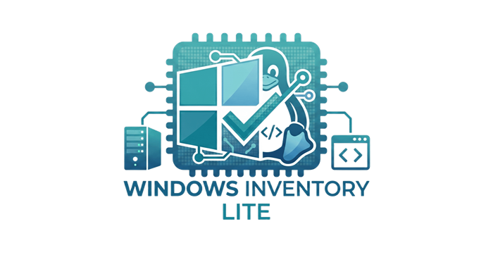
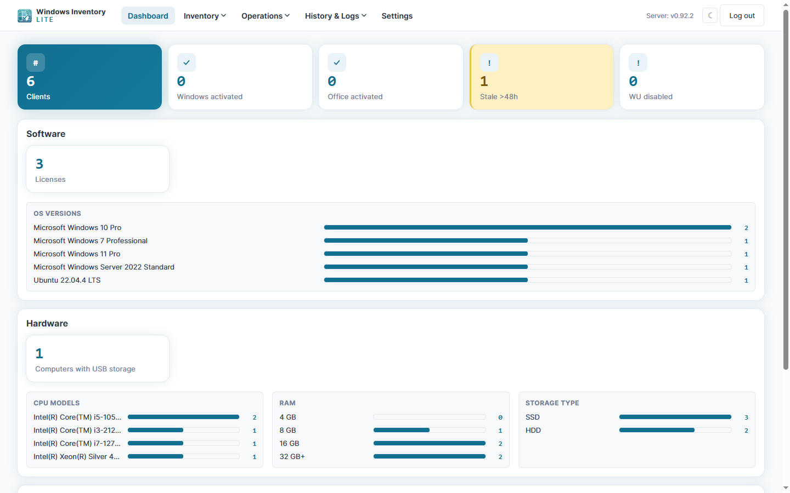
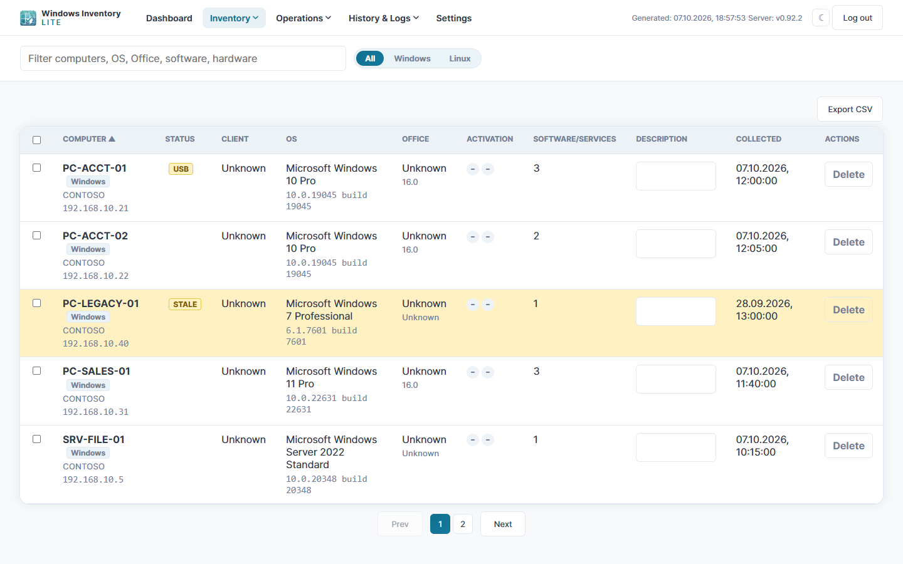
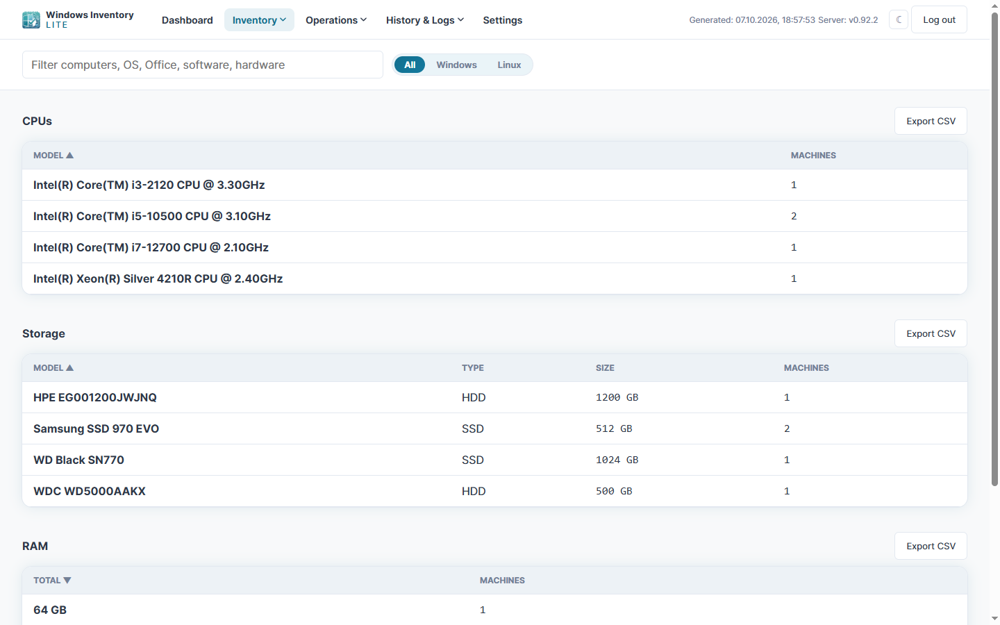
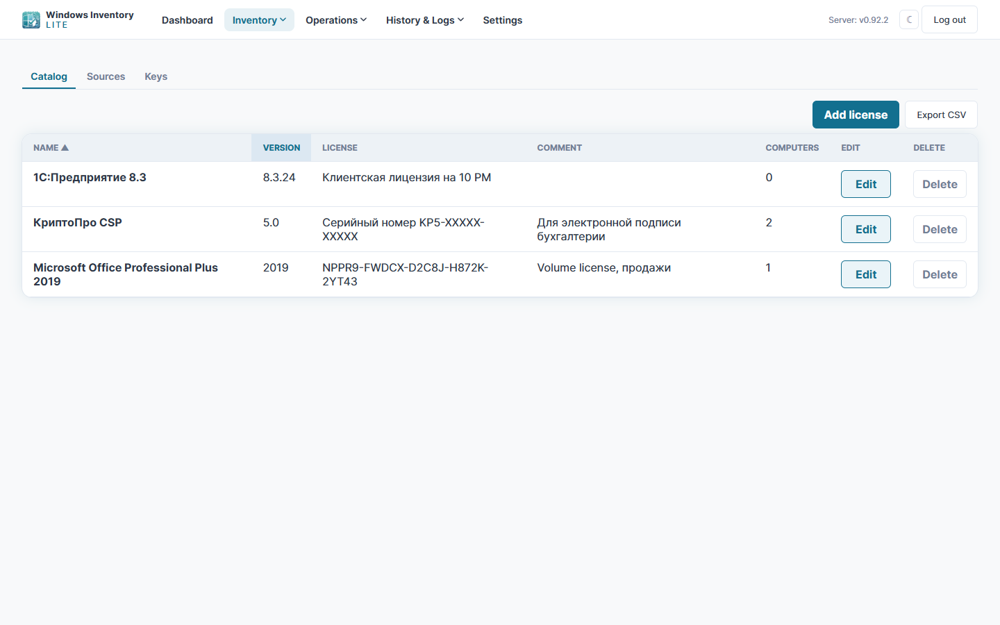

# Windows Inventory Lite

> This project was built to the author's own personal requirements. Idea and direction: the author. Implementation: Claude (Anthropic).



[](https://github.com/didimozg/windows-inventory-lite/releases)
[](https://github.com/didimozg/windows-inventory-lite/actions/workflows/ci.yml)
[](./LICENSE)

## Description

Windows Inventory Lite is a lightweight inventory tool for small Windows and Linux networks where a full-scale asset management system would be excessive. It tracks installed software, hardware specs, OS version, and Office activation status across Windows workstations, Windows servers, and Debian-family Linux hosts, through a single web dashboard.

The Windows client and server are small self-contained C# services on .NET Framework 3.5 - no IIS, SQL Server, Python, Node.js, or NuGet packages required. The Linux client is a single static Go binary reporting over HTTPS. Windows clients deploy through WinRM directly from the dashboard or via a GPO computer startup script; Linux clients deploy over SSH from the same dashboard.

## What it does

- Collects OS version, hardware (CPU, RAM, storage, USB detection), installed software, and Windows/Office activation status from every reporting machine, Windows or Linux.
- Detects real Windows and Office activation keys automatically - no admin configuration needed - via the OEM firmware key, a registry decode, or a last-5-characters partial key, whichever is available. A key matching a known Microsoft volume-license (GVLK) key is flagged, and the same key found on several machines is shown as one entry with every machine that has it, not one near-identical row per machine.
- One dashboard shows both fleets together: a merged Clients table (with an All/Windows/Linux filter and one Status column for every badge - stale, USB storage, token issues), a combined Hardware view, and shared summary tiles - plus a Software table, a Security card (clients with a Critical missing update, top clients and update severity breakdown), and a Linux-only Services table.
- Installs, updates, or uninstalls the Windows client over WinRM, or the Linux client over SSH (key or password), straight from the dashboard - no need to touch each machine by hand.
- Optional GPO deployment for Windows fleets that prefer a computer startup script over a WinRM push.
- Pushes Windows Updates (including WSUS missing-KB detection) and third-party software as independent catalogs, each with its own check interval and install-time window.
- A manually maintained software license catalog (encrypted at rest), linked to the computers that use each license - a detected key can be promoted into it with one click, prefilled.
- Optional HTTPS (self-managed certificate store, no reverse proxy required), session-based login with per-IP lockout, Active Directory description sync and computer import, and an ingestion token to restrict who can submit reports.

See [the parameters reference](./docs/parameters-reference.md) for every script parameter and configuration key, and the [threat model](./docs/threat-model.md) for what's authenticated, what's encrypted at rest, and what to check before exposing the server beyond a trusted network.

## Requirements

**Windows client:** Windows 7/8/10/11, .NET Framework 3.5+, built-in PowerShell.
**Windows server:** Windows Server or desktop Windows, .NET Framework 3.5+, one TCP port for HTTP and optionally a second for HTTPS (defaults 8080/8443).
**Linux client:** Debian or Ubuntu, amd64.
**Build host:** Windows with the .NET Framework C# compiler and PowerShell 5.1+; a Go toolchain only if rebuilding the Linux client from source (a prebuilt binary ships in the repo otherwise).

## Quick start

Build and install the server:

```powershell
.\src\Build-Server.ps1
.\src\Install-Server.ps1 -ListenPrefix 'http://+:8080/' -OpenFirewall
```

Open the dashboard at `http://<server>:8080/`, then either run the interactive wizard for a menu-driven walkthrough of every install/uninstall flow:

```powershell
.\src\Install-Wizard.ps1
```

or install one Windows client directly:

```powershell
.\src\Install-Client.ps1 -ServerUrl 'http://<server>:8080/api/v1/inventory' -IntervalHours 6
```

or push a Linux client over SSH using an RSA, Ed25519, or ECDSA private key in OpenSSH format:

```powershell
.\src\Install-ClientDebianSSH.ps1 -ComputerName 192.0.2.10 -ServerUrl 'https://<server>/api/v1/linux/inventory' -CredentialUsername root -KeyPath C:\path\to\id_ed25519
```

Full parameters for every script, every `server-config.json` key, GPO deployment, and remote WinRM pushes are in [docs/parameters-reference.md](./docs/parameters-reference.md).

## Using the dashboard

The dashboard is a single-page app with a horizontal top bar: **Dashboard** (summary tiles, a Software card, a Hardware card, and a Security card - clients with a Critical missing update, top clients by missing updates, missing updates by severity - all across both fleets), **Inventory** (a dropdown for Clients, Hardware, Software (Windows), Services (Linux), and Licenses - passive, read-only asset tracking; Clients and Hardware merge both platforms behind an All/Windows/Linux filter, and Clients carries one Status column for every badge a machine can have), **Operations** (a dropdown for Software Catalog - the Windows Updates and Third-Party Software catalogs the dashboard can push to clients, Windows Updates with its own Missing-updates/Catalog sub-tabs for WSUS-based detection - and Agent Actions - Actions/Push & Schedule/Update Package in one place, install or uninstall over WinRM/SSH with an Auto-detect mode, push outdated clients, or download a self-contained install package), **History & Logs** (a dropdown for Task History - Software Installs/Agent Push Jobs/WSUS Downloads - and System Logs - Ingestion Rejections and a raw Debug log viewer, each with its own "Clear log" button), and **Settings** (Server, Security, Credentials, Windows, Linux). Signing in uses a small dedicated login page and a real server-side session, not the browser's native Basic Auth prompt - Basic Auth (`curl -u user:pass`) still works unchanged for scripts and automation.

Inventory > Licenses has three sub-tabs: **Catalog** (the manually maintained license list, each record's key encrypted at rest, linked to the computers that use it), **Sources** (registry locations the client checks for a third-party app's own license key, e.g. a signing tool's registration - restricted to the `SOFTWARE` hive subtree), and **Keys** (every Windows/Office activation key detected automatically across the fleet - one row per distinct key, with a KMS badge when it matches a known Microsoft volume-license key, the full list of computers using it, and a "Add to licenses" button that opens the Catalog's add form prefilled with that key and computer list).

The dashboard polls every 30 seconds and updates in place - sort order, search, and expanded rows are preserved. Every table supports column sorting, a search filter, and CSV export (semicolon-delimited, UTF-8 BOM, for direct opening in Excel). Click a computer, software title, or hardware group to expand its detail row.

## Screenshots

Captured from a scratch instance seeded with fictional test data - no real hosts, credentials, or license keys.









## Documentation

- [Parameters and configuration reference](./docs/parameters-reference.md) - every script parameter, `server-config.json` key, and uninstall command.
- [HTTP API reference](./docs/api-reference.md) - every endpoint the server exposes.
- [Threat model](./docs/threat-model.md) - assets, trust boundaries, required invariants, known risks, controls, and operational security notes.
- [CHANGELOG.md](./CHANGELOG.md) - full version history.

## License

[MIT License](./LICENSE). Copyright (c) 2026 didimozg.

## Credits

Implemented by [Claude Code](https://claude.com/claude-code) (Anthropic), using these third-party agent/skill packs during development:

- [obra/superpowers](https://github.com/obra/superpowers) - brainstorming, planning, subagent-driven development, systematic debugging, and code review workflow.
- [affaan-m/ECC](https://github.com/affaan-m/ECC) - API design, frontend design, and verification-loop patterns.
- [anthropics/skills](https://github.com/anthropics/skills) - browser-based web app testing.
